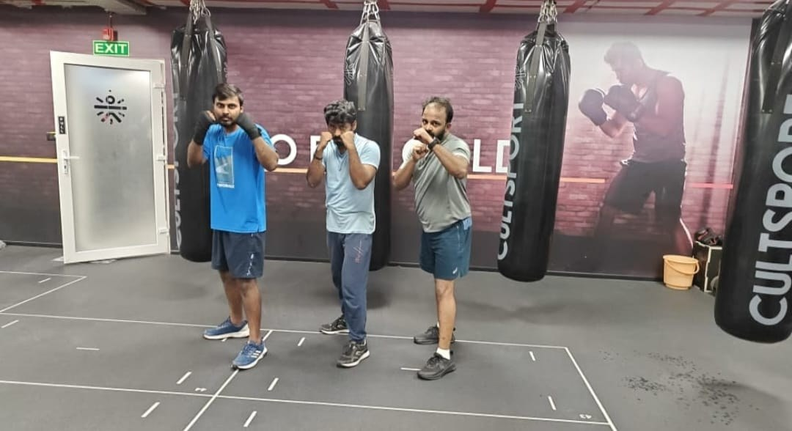
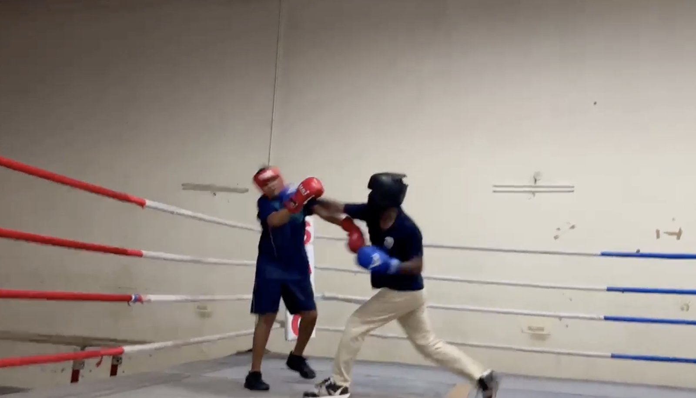
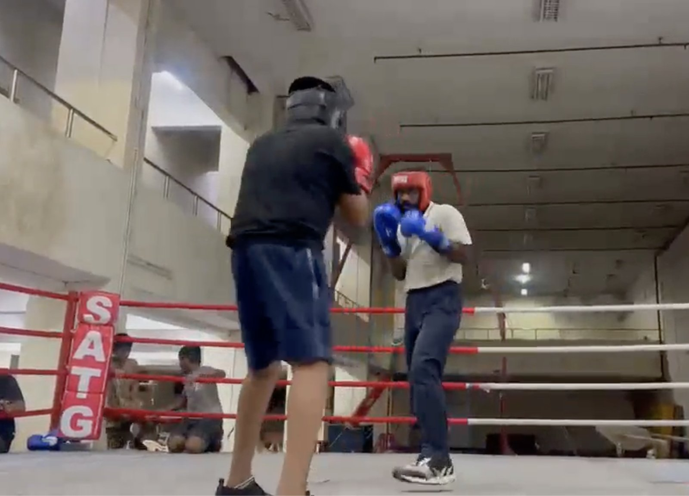
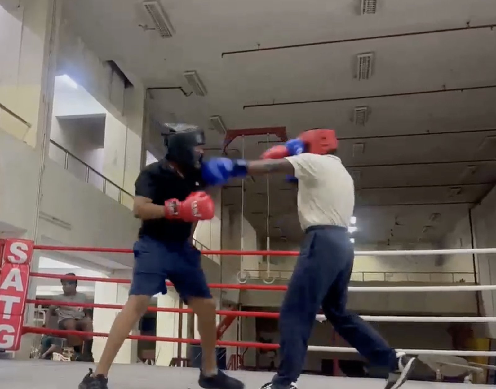
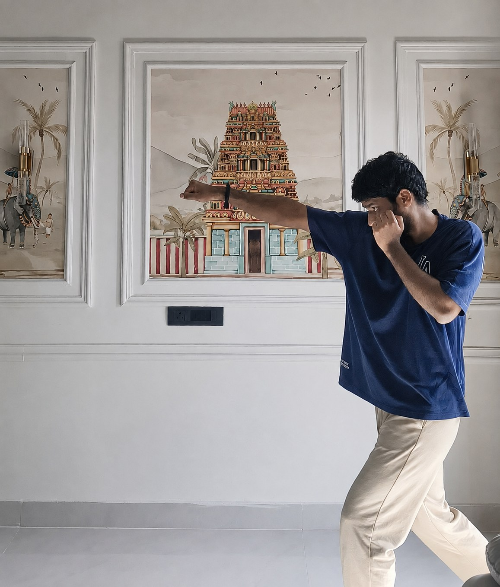

A year ago I joined a boxing bag class for fitness. Today I wake up at five to train, and it is the best part of my day. A few things I have felt along the way, in three rounds.

## Round 1: The bag class

I am a software engineer. I spend most of my day thinking about systems. Nobody who knows me saw this coming, least of all me. I never signed up for the sport. I signed up for a class, then for training, then for a spar. Each step looked small at the time.

I play badminton at times, and cricket too. I had tried plenty of workouts. None of them stayed with me after I left the gym.

Boxing did. I would come home still thinking about it. How to move, how to land a punch, how to see one coming and get out of the way. Within weeks my Instagram was nothing but boxing clips. I have never had that with a workout or a game. It was not a workout anymore. It had become a part of me. A bag class could only take me so far, and I wanted the real thing. Six months in, I joined competitive training.

## Round 2: Training

Competitive training is a different world from a class. It runs from six to nine in the morning. For those three hours nothing can reach me. No calls, no messages, no work. I did not know I needed that until I had it.

It never gets boring. It is the love for the sport that keeps me going, and the excitement of getting a little better at it. I learn something new every day. Learning to box is never complete.

Sparring is a different game from everything else in training. Throwing punches is the easy part. Not getting hit is the hard part, and you only learn that with someone in front of you. I took a good number of hits in my first spar. I was nervous before the bell and out of breath after it. The coach told me I did well, and in the same breath that there is a long way to go. I keep both. The second one is what I train with.

## Round 3: What's next

I expected boxing to make me fitter, and it has. What I did not expect was what it would do to everything else. After two hours at the stadium, nothing at a desk feels hard. A year in, I am fitter, calmer and happier than I was. It has felt good at every step.

For the first time I have a goal, and I would rather write it down so I can be held to it. I want to compete in the senior state championships next November, and represent the state at the nationals if I get the chance. That is a year of early mornings away. I know what each of them costs, and I cannot wait. I have never been this excited about something I am nowhere close to yet.

I do wish I had started years earlier. Then I remind myself that the best time to start was then, and the next best time was the day I did. The same is true for you, today. If there is a sport, or anything else, you think it is too late to start, it is not. I am nobody special. I did not have a plan. I had the next class. Start small, and take the next step when it comes.

The first step is the hardest one. Everything after that follows naturally.

## Gallery

<!--  -->
